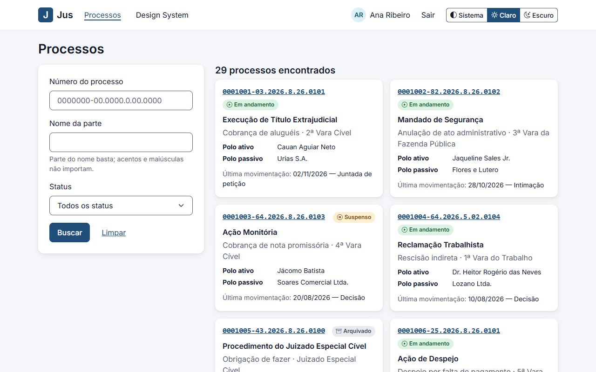
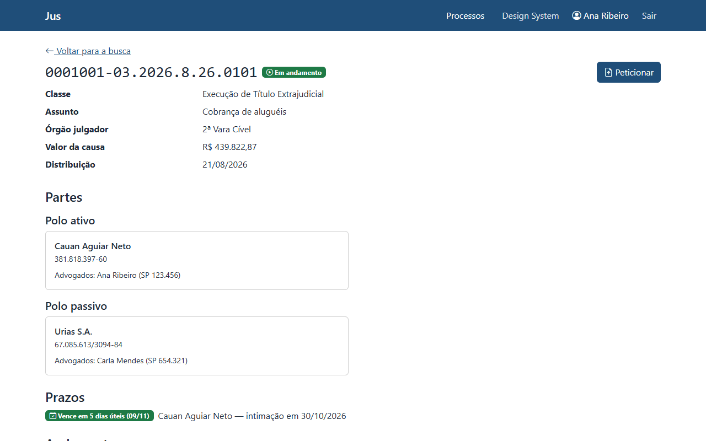
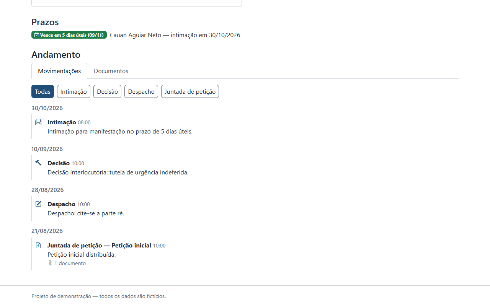
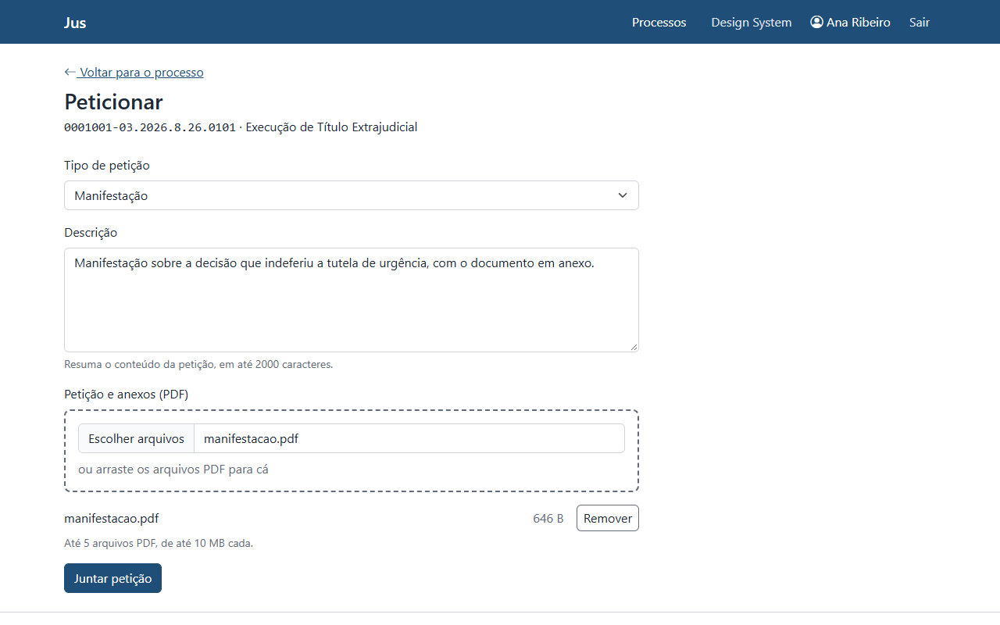
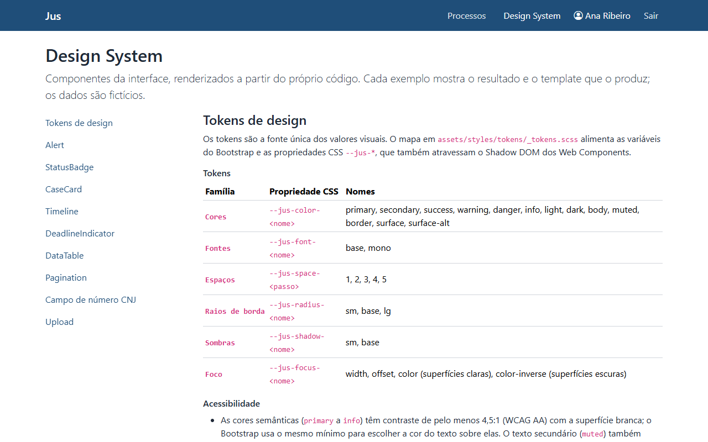
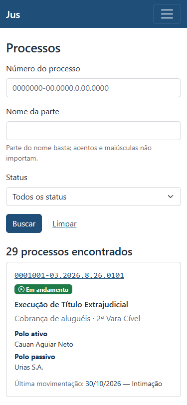
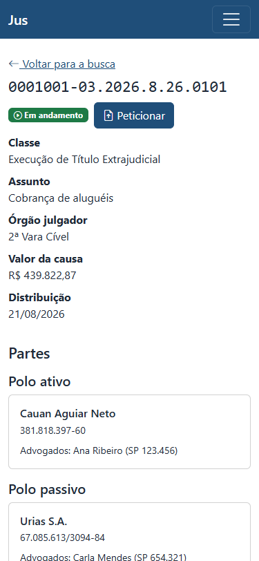

# Jus

Painel fictício de processo eletrônico (consulta, página do processo e peticionamento de documentos em PDF), feito para mostrar um Design System: componentes de interface em Twig e Web Components, sobre Symfony 7.4 e PHP 8.4.

> **Todos os dados são fictícios.** Nomes, CPFs, CNPJs, números de processo e documentos são gerados para a demonstração. O projeto não usa nome, marca ou identidade visual de nenhum sistema real, e o calendário de feriados do cálculo de prazos é ilustrativo (cada tribunal tem o seu).

## Telas

Capturas da aplicação com os dados de demonstração. Os prazos mudam com o dia em que os dados são carregados.

<table>
  <tr>
    <th align="left">Busca de processos</th>
    <th align="left">Página do processo</th>
  </tr>
  <tr>
    <td></td>
    <td></td>
  </tr>
  <tr>
    <th align="left">Andamento, com o filtro por tipo</th>
    <th align="left">Peticionamento</th>
  </tr>
  <tr>
    <td></td>
    <td></td>
  </tr>
  <tr>
    <th align="left">Catálogo do Design System</th>
    <th align="left">No celular (375 px): busca e página do processo</th>
  </tr>
  <tr>
    <td></td>
    <td>
      
      
    </td>
  </tr>
</table>

As capturas são geradas por [`tools/screenshots.mjs`](tools/screenshots.mjs) (veja [Regerar os prints](#regerar-os-prints)).

## Como rodar

### Requisitos

- **PHP 8.4** com as extensões `intl`, `pdo_sqlite`, `fileinfo` e `mbstring`. O `composer install` confere as que o [`composer.json`](composer.json) exige (`ctype`, `fileinfo`, `iconv`, `intl` e `pdo_sqlite`).
- **Composer 2**.
- **Node.js 24** (o `engines` do [`package.json`](package.json) pede `>=24`) e npm.
- **Google Chrome** instalado, para os testes de front-end (`npm test`), a auditoria das páginas e os prints. O Playwright usa o Chrome que já está na máquina: nenhum navegador é baixado. No CI, o pipeline instala o Chromium do Playwright.
- Só para o `composer ci` (cobertura de código): um driver de cobertura no PHP, **Xdebug** (como neste projeto) ou **PCOV**. Para rodar a aplicação ele não é necessário.

### Passo a passo

```bash
composer install
npm ci && npm run build
composer setup        # cria o banco SQLite, roda as migrations e carrega os dados fictícios (e os PDFs dos documentos)
php -d upload_max_filesize=10M -d post_max_size=60M -S localhost:8000 -t public
```

Abra <http://localhost:8000> e entre com uma das contas de [usuários de demonstração](#usuários-de-demonstração). O catálogo do Design System, em `/design-system`, é público.

- `composer setup` **recria** o banco (`var/data_dev.db`) e apaga os PDFs de `var/uploads/dev/`: os peticionamentos feitos antes na demonstração se vão junto. Rode-o de novo quando quiser voltar ao estado inicial.
- Para mexer no CSS e no TypeScript, `npm run watch` recompila a cada alteração.

### Limites de upload do PHP

O peticionamento aceita até 5 PDFs de 10 MB cada, e os padrões do PHP são menores (2 MB por arquivo e 8 MB por requisição). Por isso o comando acima passa os limites com `-d`. Com outro `php.ini` ou outro servidor, use valores equivalentes:

- `upload_max_filesize` de pelo menos `10M`;
- `post_max_size` grande o bastante para 5 × 10 MB mais os campos do formulário (`60M`).

Com limites menores nada quebra: o servidor recusa o envio com uma mensagem em português. Mas um envio que o formulário anuncia como permitido seria recusado.

### Onde ficam os documentos

Os PDFs ficam em `var/uploads/<ambiente>/` (fora de `public/` e do Git), com nome UUID. Cada ambiente tem o seu diretório, para que os testes nunca toquem os arquivos de desenvolvimento. O processo web precisa poder escrever nele. Os detalhes (modo `0750`, implantação em servidor) estão na [seção 3.3 do documento de design](docs/design.md#33-como-rodar).

## Usuários de demonstração

Todas as contas usam a senha **`jus-demo`**. São contas locais de demonstração, criadas pelos dados fictícios; não use essa senha em outro lugar.

| E-mail | Pessoa | Perfil | O que vê e faz |
|---|---|---|---|
| `advogado@jus.test` | Ana Ribeiro | Advogada | Atua no polo ativo de 20 dos 30 processos. Vê 29: os 27 públicos e 2 dos 3 sigilosos. O sigiloso em que ela não atua não aparece na busca, e o endereço dele responde o mesmo 404 de um número que não existe. Peticiona nos processos em que atua e que não estão arquivados. |
| `advogada2@jus.test` | Carla Mendes | Advogada | Atua no polo passivo dos 30 processos. Vê todos, inclusive os 3 sigilosos, e peticiona nos que não estão arquivados. |
| `advogado3@jus.test` | Bruno Teixeira | Advogado | Atua no polo ativo de 10 processos (um a cada três). Vê 28: os 27 públicos e o único sigiloso em que atua. Peticiona nos 10. |
| `servidor@jus.test` | João Almeida | Servidor | Vê os 30 processos, sigilosos incluídos, e baixa os documentos, mas nunca peticiona: o botão "Peticionar" não aparece e o endereço do peticionamento responde 403. |

Os números valem para os dados de `composer setup`: 30 processos (5 arquivados, 5 suspensos), 3 deles sigilosos. As regras estão em [`LegalCaseVoter`](src/Security/LegalCaseVoter.php) e na [seção 5.5 do documento de design](docs/design.md#55-autorização-legalcasevoter). Os prazos são gerados em relação ao dia em que o `composer setup` roda, para que a demonstração mostre os estados de urgência (no prazo, atenção, vence hoje, vencido e cumprido).

## Qualidade

### `composer ci`

Roda, nesta ordem, o mesmo que o pipeline roda, mais os testes de front-end:

1. `composer validate --strict`;
2. PHP-CS-Fixer (`@Symfony`), em modo de verificação;
3. lints do Symfony e do Doctrine: container, YAML, Twig e o mapeamento das entidades;
4. PHPStan no nível `max`, sem baseline e sem `ignoreErrors`;
5. PHPUnit (unitários, de componente, de integração e funcionais) com cobertura, em cache de teste recém-construído;
6. `src/Domain/` com **100% de cobertura de linhas** (`composer coverage:domain` falha se um arquivo ficar abaixo);
7. `npm run ci`: ESLint (`strictTypeChecked`), Stylelint, `tsc --noEmit`, Vitest em modo browser (com axe-core) e o build de produção.

No Windows, um teste que confere o modo `0750` do diretório de documentos só roda no Linux e aparece como pulado. Para o ciclo rápido, `composer qa` roda o estilo, os lints, o PHPStan e o PHPUnit (sem cobertura e sem o front-end), e `npm run ci` roda só o front-end.

O primeiro `npm test` usa o Google Chrome instalado (canal `chrome` do Playwright). No CI, as variáveis `CI` ou `TF_BUILD` fazem o Vitest usar o Chromium do Playwright.

### Auditoria das páginas

`npm run audit:pages` confere as páginas que a aplicação realmente renderiza, com o servidor, o CSS e o JavaScript do build: axe-core com as regras WCAG 2.0, 2.1 e 2.2 (níveis A e AA) e ausência de rolagem horizontal em 1280 px e em 375 px, uma passada pelo teclado no peticionamento e uma passada com o JavaScript desligado (busca, abas e um peticionamento inteiro). Não faz parte do `composer ci`, porque precisa da aplicação rodando:

```bash
composer setup && npm run build
php -d upload_max_filesize=10M -d post_max_size=60M -S 127.0.0.1:8123 -t public
npm run audit:pages -- --base-url=http://127.0.0.1:8123   # em outro terminal
```

A auditoria **grava peticionamentos** nos dados de demonstração (quatro por rodada); `composer setup` devolve os dados ao estado inicial. O detalhe de cada verificação está na [seção 10.1 do documento de design](docs/design.md#101-auditoria-das-páginas-renderizadas-npm-run-auditpages).

### Regerar os prints

`npm run screenshots -- --base-url=http://127.0.0.1:8123`, com a aplicação rodando como acima, entra com a conta de demonstração e grava as capturas de [`docs/screenshots/`](docs/screenshots/) (só a janela, em 1280 × 800 e em 375 × 812). O formulário de peticionamento é preenchido, mas não é enviado: o script não grava nada nos dados.

### Pipeline

[`azure-pipelines.yml`](azure-pipelines.yml) define o pipeline do Azure DevOps (em `push` e PR para `main`, agente `ubuntu-latest`): estágio *Quality* (PHP e front-end em paralelo) e estágio *Test* (PHPUnit com a cobertura do domínio e os Web Components no Chromium do Playwright). **A conexão do repositório com o Azure DevOps ainda está pendente**, então não há badge de status aqui: ele entra quando o pipeline estiver rodando por lá.

## Destaques técnicos

- **Regra do número CNJ, nas duas linguagens.** O value object [`CnjNumber`](src/Domain/CnjNumber.php) (PHP) e [`cnj.ts`](assets/shared/cnj.ts) (TypeScript, para a máscara e a validação no navegador) implementam o dígito verificador canônico (ISO 7064 Mod 97-10) e são testados contra os mesmos casos, em [`cnj-numbers.json`](tests/fixtures/cnj-numbers.json), lidos pelo [PHPUnit](tests/Unit/Domain/CnjNumberTest.php) e pelo [Vitest](assets/shared/cnj.test.ts). O servidor decide; o JavaScript só antecipa o feedback ([ADR 0004](docs/adr/0004-servidor-como-fonte-da-verdade.md)).
- **Prazos em dias úteis, com feriados.** O [`DeadlineCalculator`](src/Domain/Deadline/DeadlineCalculator.php) exclui o dia do começo, fins de semana, feriados e o recesso forense (20/12 a 20/01). O [`NationalHolidayCalendar`](src/Domain/Deadline/NationalHolidayCalendar.php) traz os feriados nacionais fixos e os móveis, calculados a partir da [Páscoa](src/Domain/Deadline/Easter.php). O vencimento nunca é gravado: é calculado a cada renderização, com o relógio injetado. `src/Domain/` é PHP puro (um [teste de arquitetura](tests/Unit/ArchitectureTest.php) proíbe Symfony e Doctrine ali) e tem 100% de cobertura de linhas.
- **Sigilo na consulta e no Voter, com teste de paridade.** A busca aplica a regra de visibilidade na própria consulta ([`LegalCaseRepository::onlyVisibleTo()`](src/Repository/LegalCaseRepository.php)) e as rotas consultam o [`LegalCaseVoter`](src/Security/LegalCaseVoter.php); o [`SearchVisibilityParityTest`](tests/Integration/SearchVisibilityParityTest.php) garante que as duas decidem igual. Quem não pode ver um processo sigiloso recebe o mesmo 404 de um número que não existe, na página, no peticionamento e no download: o sistema nunca revela que ele existe. O 403 fica para quem pode ver e não pode agir.
- **Número fixo de consultas por tela.** Qualquer que seja o tamanho da página: 5 consultas numa busca com resultados, 3 na página do processo (em qualquer aba), 2 no formulário de peticionamento e 2 no download, conferidas por testes funcionais com o [`QueryRecorder`](tests/Support/QueryRecorder.php) (por exemplo, [`CaseSearchPageTest`](tests/Functional/CaseSearchPageTest.php) e [`CasePageTest`](tests/Functional/CasePageTest.php)).
- **Web Components com aprimoramento progressivo.** Três Custom Elements puros, sem biblioteca, em [`assets/components/`](assets/components/): `<jus-numero-processo>` (máscara e validação, sobre o input nativo, no lugar), `<jus-filtro-timeline>` e `<jus-upload>` (Shadow DOM, sobre a base [`JusElement`](assets/components/jus-element.ts)). Sem JavaScript, o controle nativo que cada um envolve continua funcionando. Os design tokens são CSS custom properties, que atravessam o Shadow DOM. Os testes rodam num navegador de verdade, com axe-core em cada componente ([ADR 0001](docs/adr/0001-abordagem-hibrida-twig-e-web-components.md), [0002](docs/adr/0002-design-tokens-como-css-custom-properties.md), [0005](docs/adr/0005-vitest-em-modo-browser.md) e [0007](docs/adr/0007-campo-cnj-aprimora-o-input-nativo.md)).
- **Upload seguro.** O tipo PDF é conferido pelo **conteúdo** do arquivo, e não pelo nome nem pelo tipo que o navegador declara; os limites (5 arquivos, 10 MB cada) vêm de um lugar só, [`FilingLimits`](src/Filing/FilingLimits.php). O [`DocumentStorage`](src/Filing/DocumentStorage.php) é a única classe que toca o disco: grava fora de `public/`, com nome UUID v7, e só resolve nomes nesse formato (sem travessia de diretórios). O [`FilingService`](src/Filing/FilingService.php) grava o peticionamento numa transação e remove os arquivos se algo falhar. O [download](src/Controller/DocumentController.php) usa `attachment`, `nosniff` e `no-store`.
- **Páginas que funcionam sem JavaScript.** O servidor entrega a página completa: a busca é um formulário GET, as abas do processo são links, e o peticionamento é um POST `multipart/form-data` comum que termina num redirect 303. A [auditoria das páginas](tools/audit/pages.mjs) refaz esses fluxos com o JavaScript desligado.
- **Acessibilidade medida.** axe-core em todo teste de componente, com a paleta real dos tokens, e na auditoria das páginas (WCAG 2.2, A e AA); anel de foco com contraste mínimo de 3:1; estado e erro nunca só por cor.

## Arquitetura

Symfony 7.4 e PHP 8.4 (`strict_types` em todos os arquivos), Twig e Symfony UX Twig Components, Doctrine ORM com SQLite, Webpack Encore, TypeScript, Sass e Bootstrap 5.3, Vitest 5 em modo browser, PHPStan, PHP-CS-Fixer, ESLint e Stylelint.

- [**Documento de design**](docs/design.md): escopo, domínio, regras de negócio, componentes, telas e rotas, tratamento de erros, testes e CI.
- [**Decisões de arquitetura (ADRs)**](docs/adr/README.md): sete registros, com contexto, consequências e alternativas descartadas.
- [**Diagramas**](docs/diagrams/README.md), em Mermaid: [contexto e containers](docs/diagrams/contexto-e-containers.md), [entidades](docs/diagrams/entidades.md) e [sequência do peticionamento](docs/diagrams/sequencia-peticionamento.md).

## Licença

[MIT](LICENSE) © 2026 Pedro Huguenin.
