# Contexto e containers

O Jus é um monolito Symfony. A pessoa (advogado ou servidor) usa o navegador, que recebe do servidor a página já completa, desenhada pelo Twig e pelos Twig Components; o bundle do Webpack Encore, com os Web Components e os comportamentos de layout, só aprimora essa página (sem ele, ela continua funcionando). Cada requisição passa pelo firewall e chega a um controller, que consulta o `LegalCaseVoter` nas rotas de um processo e usa o domínio, os repositórios Doctrine e, no peticionamento, o `FilingService`. Os dados ficam em um arquivo SQLite, e os PDFs dos documentos, em disco, fora de `public/`, e só o `DocumentStorage` toca nesses arquivos. O pipeline do Azure DevOps roda à parte da aplicação: ele só constrói e testa o código.

Em `ENV`, leia o ambiente (`dev`, `test`, `prod`): cada um tem o seu banco e o seu diretório de PDFs.

```mermaid
flowchart TD
    pessoa["Advogado ou servidor"]

    subgraph navegador["Navegador"]
        pagina["Página HTML completa"]
        bundle["Bundle do Encore<br/>Web Components, comportamentos de layout,<br/>Bootstrap e CSS"]
    end

    subgraph symfony["Aplicação Symfony 7.4 (PHP 8.4)"]
        seguranca["Security<br/>firewall, login e controle de acesso"]
        voter["LegalCaseVoter"]
        controllers["Controllers<br/>Home, Case, Filing, Document, DesignSystem, Security"]
        forms["Form types e validação"]
        templates["Twig, Twig Components<br/>e form theme"]
        dominio["Domínio em PHP puro<br/>CnjNumber, DeadlineCalculator, enums"]
        repos["Entidades e repositórios Doctrine"]
        filing["FilingService"]
        storage["DocumentStorage"]
    end

    sqlite[("SQLite<br/>var/data_ENV.db")]
    pdfs[("PDFs dos documentos<br/>var/uploads/ENV/")]
    encore["Webpack Encore<br/>assets/ (TypeScript e Sass) para public/build/"]

    pessoa -->|"usa"| pagina
    pagina -->|"requisição HTTP"| seguranca
    seguranca --> controllers
    controllers --> forms
    controllers -->|"VIEW e FILE"| voter
    controllers --> dominio
    controllers --> repos
    controllers -->|"peticionamento"| filing
    controllers -->|"download"| storage
    controllers --> templates
    templates -->|"HTML completo"| pagina
    templates -->|"encore_entry_link_tags e encore_entry_script_tags"| bundle
    bundle -->|"aprimora"| pagina
    encore -->|"npm run build"| bundle
    repos --> dominio
    repos --> sqlite
    filing --> storage
    filing --> repos
    storage --> pdfs

    subgraph pipeline["Pipeline, à parte (ainda não conectado ao Azure DevOps)"]
        github["Repositório no GitHub"]
        azure["azure-pipelines.yml<br/>Quality: PHP e front-end<br/>Test: PHPUnit e Vitest"]
    end

    github -.->|"push e pull request para main"| azure
```

Onde cada caixa está no código:

- Security: `config/packages/security.yaml` (firewall e controle de acesso) e `src/Security/LegalCaseVoter.php`.
- Controllers: `src/Controller/`; formulários em `src/Form/`.
- Twig e Twig Components: `templates/` e `src/Twig/`; o form theme é `templates/form/jus_theme.html.twig`.
- Domínio: `src/Domain/`, sem Symfony nem Doctrine.
- Entidades e repositórios: `src/Entity/`, `src/Repository/` e o tipo `cnj_number` em `src/Doctrine/Type/`.
- Peticionamento: `src/Filing/` (`FilingService`, `DocumentStorage`).
- Bundle do Encore: `assets/` e `webpack.config.js` (ADR [0003](../adr/0003-webpack-encore-em-vez-de-assetmapper.md)); os Web Components estão em `assets/components/` (ADR [0001](../adr/0001-abordagem-hibrida-twig-e-web-components.md)).
- Pipeline: `azure-pipelines.yml`.
