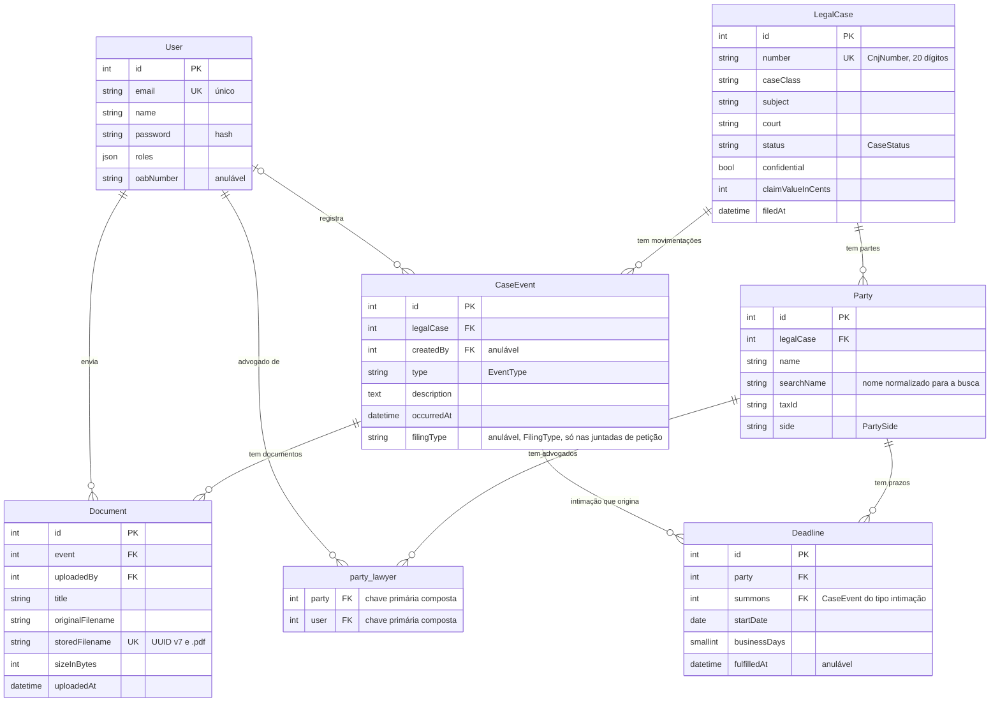

# Entidades

O modelo gira em torno do `LegalCase` (o processo), que tem partes (`Party`) e movimentações (`CaseEvent`). Cada movimentação pode ter documentos (`Document`, os PDFs). Um advogado (`User` com o perfil de advogado) representa zero ou mais partes pela tabela de junção `party_lawyer`, e é essa relação que a autorização lê. Uma intimação (`CaseEvent` do tipo intimação) origina um prazo (`Deadline`) para uma parte. O vencimento do prazo nunca é guardado: é calculado a partir do início e dos dias úteis (ADR [0004](../adr/0004-servidor-como-fonte-da-verdade.md)).

Os campos são os do mapeamento Doctrine (`src/Entity/`), com os nomes das propriedades. Os campos de chave estrangeira aparecem pelo nome da relação (`legalCase`, `party`…). O comentário de um campo diz quando ele é opcional (`anulável`) e qual enum de `src/Domain/LegalCase/` o preenche. O `User` fica na tabela `app_user`, e `LegalCase.number` é o tipo `cnj_number`, guardado como 20 dígitos.

Cardinalidades que o mapeamento impõe:

- `Party.legalCase`, `CaseEvent.legalCase`, `Document.event`, `Document.uploadedBy`, `Deadline.party` e `Deadline.summons` são obrigatórios (`nullable: false`). Só `CaseEvent.createdBy` pode ser nulo.
- O processo é dono das suas partes e das suas movimentações, e a movimentação, dos seus documentos (`cascade: persist` e `orphanRemoval`). As linhas de `party_lawyer` saem junto com a parte ou o usuário (`ON DELETE CASCADE` na migration).
- As coleções já vêm ordenadas pelo mapeamento: partes por `id`, movimentações da mais recente para a mais antiga, e advogados da parte por nome (design, seção 5.1).
- O banco tem as restrições de unicidade de `User.email`, `LegalCase.number` e `Document.storedFilename`.

Onde está no código:

- As entidades e o mapeamento Doctrine: `src/Entity/` (`User`, `LegalCase`, `Party`, `CaseEvent`, `Document`, `Deadline`); a tabela `party_lawyer` é a junção `ManyToMany` de `Party::$lawyers`.
- Os enums: `src/Domain/LegalCase/` (`CaseStatus`, `PartySide`, `EventType`, `FilingType`); o número do processo: `src/Domain/CnjNumber.php` e o tipo `cnj_number`, em `src/Doctrine/Type/CnjNumberDoctrineType.php`.
- O esquema do banco: `migrations/`.
