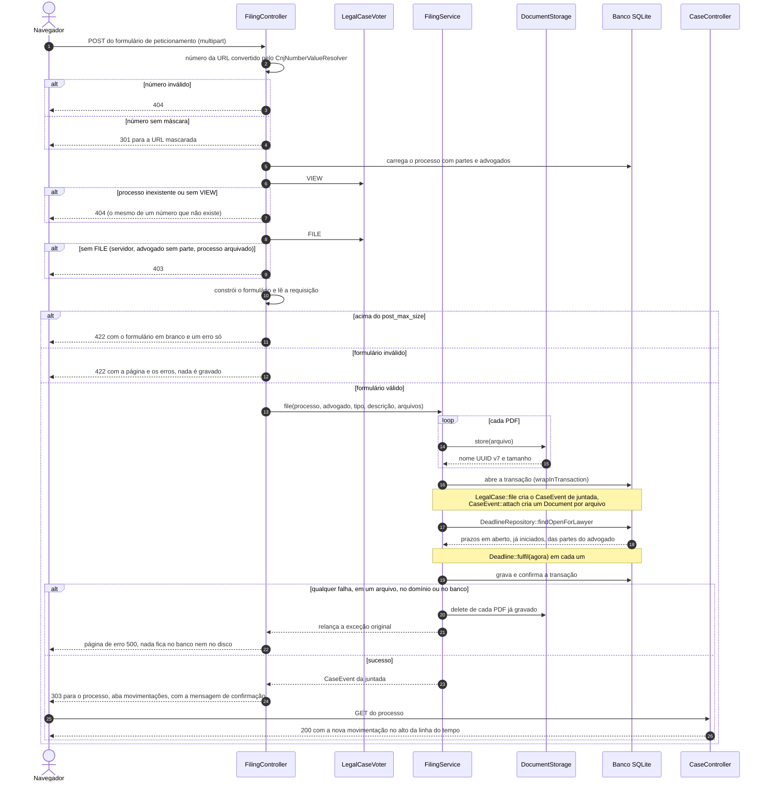

# Sequência do peticionamento

Um advogado junta uma petição, com um ou mais PDFs, a um processo. O diagrama começa depois do firewall (um visitante é mandado para o login) e segue a ordem de decisões do `FilingController`: o número da URL é resolvido, a URL é normalizada para a forma mascarada, quem não pode **ver** o processo recebe o mesmo 404 de um número que não existe, quem pode ver mas não pode **peticionar** recebe 403, e só então o formulário é construído e a requisição é lida. Se o formulário é válido, o `FilingService` grava os PDFs com o `DocumentStorage` e, em uma única transação, registra a juntada, anexa os documentos e cumpre os prazos em aberto do advogado; qualquer falha apaga os arquivos já gravados e relança o erro. O sucesso termina em um redirect 303, e a página do processo mostra a nova movimentação.

Onde cada passo está no código:

- Decisões e respostas HTTP: `src/Controller/FilingController.php`, `src/ValueResolver/CnjNumberValueResolver.php` e `src/Security/LegalCaseVoter.php`; as regras de 404 e 403 estão na seção 5.5 do [design](../design.md).
- Gravação, transação e limpeza: `src/Filing/FilingService.php` e `src/Filing/DocumentStorage.php`.
- Regras do domínio exercidas na transação: `LegalCase::file()`, `CaseEvent::attach()` e `Deadline::fulfil()`, em `src/Entity/`; a consulta dos prazos, em `src/Repository/DeadlineRepository.php`.
- Os limites dos arquivos (quantidade, tamanho, tipo) vêm de `src/Filing/FilingLimits.php` e são conferidos pelo formulário, antes do serviço.
- Uma falha dentro da transação fecha o `EntityManager`; o controlador não tenta se recuperar, e a exceção chega à página de erro 500.
